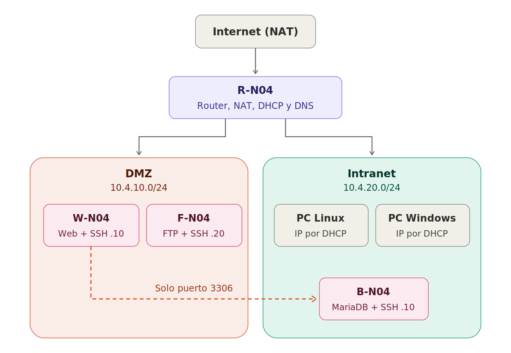

# P0.0-ASIXc2C-G04 · Desplegament d'infraestructura

**Mòdul 0379** · Projecte intermodular d'administració de sistemes informàtics en xarxa · Institut Tecnològic de Barcelona

Infraestructura d'una empresa amb tres zones separades per un router: **Internet**, una **DMZ** amb els serveis que s'ofereixen (web i FTP) i una **Intranet** protegida amb la base de dades i els equips dels usuaris. Una aplicació web mostra el llistat d'equipaments d'educació de Barcelona (Open Data BCN) carregat a la base de dades.

## Màquines

| Màquina | Zona | IP | Serveis |
|---|---|---|---|
| **R-N04** | Router | `10.4.10.1` · `10.4.20.1` | Firewall (iptables), NAT, DHCP i DNS (dnsmasq) |
| **W-N04** | DMZ | `10.4.10.10` | Apache + PHP, aplicació web |
| **F-N04** | DMZ | `10.4.10.20` | FTP (vsftpd) |
| **B-N04** | Intranet | `10.4.20.10` | MariaDB (`crud_db`) |
| **PC Linux** · **PC Windows** | Intranet | DHCP | Clients |

Tots els equips tenen SSH i l'usuari **`bchecker`** / `bchecker121`.

## Accés ràpid

| | |
|---|---|
| 🌐 Aplicació | `http://W-N04/app/app/` (des de la Intranet) |
| 📂 FTP | `ftp -p 10.4.10.20` |
| 🔒 Seguretat | De la DMZ a la Intranet només passa el port **3306** (W-N04 → B-N04) |

## Equip

| Membre | Responsabilitats |
|---|---|
| **Oriol Coll Llorens** | Servidor web W-N04, aplicació PHP, repositori i desplegament amb git, servidor FTP F-N04, client Linux |
| **Mario Cabeza de la Torre** | Servidor de base de dades B-N04, importació del CSV d'Open Data, còpia de seguretat |
| **Jordi Bravo Salas** | Router R-N04 (xarxes, NAT, firewall, DHCP i DNS), client Windows |

La planificació es va fer en **3 sprints** a ProofHub: [docs/00-planificacion.md](docs/00-planificacion.md).

## Documentació

| | Document |
|---|---|
| 00 | [Planificació](docs/00-planificacion.md) |
| 01 | [Arquitectura](docs/01-arquitectura.md) |
| 02 | [Router R-N04](docs/02-servidor-router.md) |
| 03 | [Base de dades B-N04](docs/03-servidor-bbdd.md) |
| 04 | [Servidor web W-N04](docs/04-servidor-web.md) |
| 05 | [Servidor FTP F-N04](docs/05-servidor-ftp.md) |
| 06 | [Clients](docs/06-clientes.md) |
| 07 | [Git i desplegament a producció](docs/07-git-despliegue.md) |
| 08 | [Proves](docs/08-pruebas.md) |
| 09 | [Manual d'administrador](docs/09-manual-admin.md) |
| 10 | [Manual d'usuari](docs/10-manual-cliente.md) |

## Estructura del repositori

| Carpeta | Contingut |
|---|---|
| `docs/` | Documentació en Markdown i captures (`docs/img/`) |
| `app/` | Aplicació web PHP |
| `sql/` | Script d'importació del CSV i còpia de seguretat de la base de dades |
| `config/` | Còpies dels fitxers de configuració dels servidors (sense contrasenyes) |
