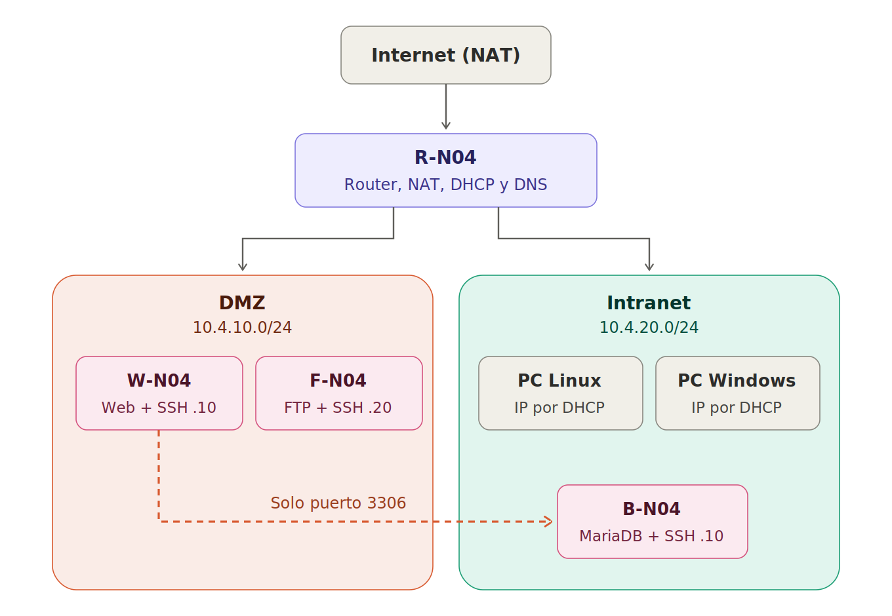

# Arquitectura de la infraestructura

Infraestructura de red de una empresa con tres zonas separadas por un router: **Internet (NAT)**, **DMZ** para los servicios accesibles y **Intranet** para los datos y los equipos internos. El router es el único equipo conectado a las tres redes y controla qué tráfico puede pasar de una zona a otra.

## Índice

1. [Diagrama](#1-diagrama)
2. [Zonas de red](#2-zonas-de-red)
3. [Máquinas y direccionamiento](#3-máquinas-y-direccionamiento)
4. [Tráfico permitido entre zonas](#4-tráfico-permitido-entre-zonas)
5. [Cómo viaja la información](#5-cómo-viaja-la-información)
6. [Decisiones de diseño](#6-decisiones-de-diseño)
7. [Fase de instalación](#7-fase-de-instalación)
8. [Nomenclatura](#8-nomenclatura)

---

## 1. Diagrama

---

## 2. Zonas de red

| Zona | Red en IsardVDI | Rango | Qué contiene | Nivel de protección |
|---|---|---|---|---|
| **Internet** | Default (NAT) | Asignado por IsardVDI | Salida a Internet | Exterior |
| **DMZ** | DMZ | `10.4.10.0/24` | Servicios que se ofrecen: web y FTP | Media: expuesta, pero aislada de la Intranet |
| **Intranet** | Intranet | `10.4.20.0/24` | Base de datos y equipos de los usuarios | Alta: solo se entra por reglas concretas |

Un símil: el router es el **portero** del edificio, la DMZ es la **recepción** (lo que ven los de fuera) y la Intranet son las **oficinas privadas**.

---

## 3. Máquinas y direccionamiento

| Máquina | Tarjetas | Red | IP | Puerta de enlace | Servicios (puerto) | Responsable |
|---|---|---|---|---|---|---|
| **R-N04** | 3 | Default | Por DHCP de IsardVDI | La de IsardVDI | NAT | Jordi |
| | | DMZ | `10.4.10.1/24` | — | DNS (53), DHCP (67) | |
| | | Intranet | `10.4.20.1/24` | — | DNS (53), DHCP (67) | |
| **W-N04** | 1 | DMZ | `10.4.10.10/24` (fija) | `10.4.10.1` | HTTP (80), SSH (22) | Oriol |
| **F-N04** | 1 | DMZ | `10.4.10.20/24` (fija) | `10.4.10.1` | FTP (21), SSH (22) | Mario |
| **B-N04** | 1 | Intranet | `10.4.20.10/24` (fija) | `10.4.20.1` | MariaDB (3306), SSH (22) | Mario |
| **PC Linux** | 1 | Intranet | Por DHCP (`10.4.20.100`–`150`) | La da el DHCP | — | Jordi |
| **PC Windows** | 1 | Intranet | Por DHCP (`10.4.20.100`–`150`) | La da el DHCP | — | Jordi |

- **Solo el router tiene salida directa a Internet.** El resto de máquinas tienen una única tarjeta en su zona y salen a través del router (su puerta de enlace es la `.1`).
- **Los servidores tienen IP fija**, para que el DNS y los demás servicios los encuentren siempre en la misma dirección.
- **Los clientes usan DHCP**, como en una oficina real: se conectan y reciben IP, puerta de enlace y DNS automáticamente.

<!-- TODO Jordi: confirmar el servicio usado para DHCP y DNS (p. ej. dnsmasq) y el rango DHCP final -->

---

## 4. Tráfico permitido entre zonas

| Origen | Destino | Puerto | ¿Permitido? | Motivo |
|---|---|---|---|---|
| Intranet | Internet | Todos | ✅ | Navegación y actualizaciones de los equipos internos |
| DMZ | Internet | Todos | ✅ | Actualizaciones de los servidores |
| Clientes (Intranet) | W-N04 | 80 | ✅ | Usar la aplicación web |
| Clientes (Intranet) | F-N04 | 21 | ✅ | Subir y descargar archivos |
| Intranet | Servidores | 22 | ✅ | Administración por SSH |
| Todas | R-N04 | 53, 67 | ✅ | DNS y DHCP |
| **W-N04** | **B-N04** | **3306** | ✅ | **La aplicación lee los datos. Único paso abierto de la DMZ a la Intranet** |
| DMZ | Intranet | Resto | ❌ | Si un servidor de la DMZ es atacado, no puede llegar a la Intranet |
| Internet | Intranet | Todos | ❌ | La Intranet nunca se expone al exterior |

El router necesita para esto:
- **Reenvío de paquetes** (`ip_forward`) activado, para pasar tráfico entre redes.
- **NAT** de salida en la tarjeta Default, para que las redes internas salgan a Internet con la IP del router.
- **Reglas de cortafuegos** que apliquen la tabla anterior.

---

## 5. Cómo viaja la información

**Un PC se conecta a la red**
El PC no tiene IP al arrancar. Pide una y el DHCP del router le asigna una libre del rango (por ejemplo `10.4.20.101`), junto con la puerta de enlace y el DNS.

**Un usuario abre la aplicación**
El PC escribe `http://W-N04`. El DNS del router traduce el nombre a `10.4.10.10`. Como esa IP es de otra red, el PC envía la petición a su puerta de enlace (el router), que la reenvía a la DMZ hasta el servidor web.

**La aplicación lee los datos**
El servidor web pide los datos a `10.4.20.10:3306`. El router comprueba que el origen es W-N04 y el puerto es el 3306, y lo deja pasar a la Intranet. La base de datos responde por el mismo camino.

**Un ataque desde la DMZ**
Si alguien compromete el FTP e intenta conectarse a la base de datos, el router bloquea el tráfico: desde la DMZ solo W-N04 puede llegar a B-N04, y solo por el puerto 3306.

---

## 6. Decisiones de diseño

| Decisión | Motivo |
|---|---|
| Web y FTP en la **DMZ** | Son los servicios que se ofrecen. Si se atacan, el daño queda aislado fuera de la Intranet |
| Base de datos en la **Intranet** | Contiene la información de la empresa: es lo que más hay que proteger |
| Un **único paso** DMZ → Intranet (W-N04 → B-N04, puerto 3306) | La web necesita los datos, pero no hace falta abrir nada más |
| **DHCP y DNS en el router** | El router ya está conectado a todas las redes; un solo equipo da el servicio a todas |
| Rangos **`10.4.x.x`** | El `4` corresponde al grupo 04: evita choques con otros grupos y se ve de quién es cada red |
| `.1` para el router, `.10`/`.20` para servidores, `.100`+ para DHCP | Convención fácil de recordar: cada tipo de equipo tiene su tramo |
| **MariaDB** en vez de MySQL | Libre y compatible con MySQL: mismo puerto, mismos comandos y misma conexión desde PHP |

---

## 7. Fase de instalación

Mientras el router no está operativo, los servidores no pueden salir a Internet por él. Durante esta fase, cada servidor tiene **una segunda tarjeta en la red Default** de IsardVDI para poder instalar paquetes.

| Fase | Tarjetas de cada servidor |
|---|---|
| Instalación (Sprint 1) | Default + su zona (DMZ o Intranet) |
| Final | Solo su zona, saliendo por el router |

Cuando el router funciona, se quita la tarjeta Default de los servidores y se pone la puerta de enlace y el DNS del router en su configuración de red (netplan).

> Las redes DMZ e Intranet tienen que ser **compartidas** entre los miembros del grupo en IsardVDI. Una red de tipo "Personal" solo conecta los escritorios de un mismo usuario.

---

## 8. Nomenclatura

| Elemento | Formato | Ejemplo |
|---|---|---|
| Router | `R-NCC` | `R-N04` (también resoluble como `R`) |
| Servidor web | `W-NCC` | `W-N04` |
| Servidor de BBDD | `B-NCC` | `B-N04` |
| Servidor FTP | `F-NCC` | `F-N04` |
| Usuario obligatorio | `bchecker` / `bchecker121` | En todos los equipos |
| Proyecto y repositorio | `P0.0-ASIXc2gC-Gnn` | `P0.0-ASIXc2C-G04` |

`NCC` es el número de equipo (`N04`) y `Gnn` el número de grupo (`G04`).
