# Servidor FTP (F-N04)

Servidor **vsftpd** situado en la **DMZ**. Permite a los usuarios de la Intranet subir y descargar archivos. Cada usuario FTP queda encerrado en su propia carpeta.

**Responsable:** Oriol Coll Llorens

> **De un vistazo**
>
> | | |
> |---|---|
> | 📍 Zona | DMZ · `10.4.10.20` |
> | 📂 Servicio | vsftpd 3.0.5 · puerto 21 (modo pasivo `40000-40100`) |
> | 👤 Usuario FTP | `usuario_ftp`, encerrado en su carpeta |
> | 🔒 Acceso | Solo usuarios de la lista `/etc/vsftpd.userlist` |

## Índice

1. [Datos de la máquina](#1-datos-de-la-máquina)
2. [Hostname y usuario bchecker](#2-hostname-y-usuario-bchecker)
3. [Configuración de red](#3-configuración-de-red)
4. [Instalación de vsftpd](#4-instalación-de-vsftpd)
5. [Configuración de vsftpd](#5-configuración-de-vsftpd)
6. [Usuario FTP y permisos](#6-usuario-ftp-y-permisos)
7. [Prueba desde el PC Linux](#7-prueba-desde-el-pc-linux)
8. [SSH](#8-ssh)
9. [Problemas encontrados y soluciones](#9-problemas-encontrados-y-soluciones)
10. [Resumen de comprobaciones](#10-resumen-de-comprobaciones)

---

## 1. Datos de la máquina

| Campo | Valor |
|---|---|
| Hostname | F-N04 |
| Sistema operativo | Ubuntu Server 22.04 LTS (plantilla mínima de IsardVDI) |
| Servicio | vsftpd 3.0.5 |
| Red | DMZ (`10.4.10.0/24`) |
| IP | `10.4.10.20/24` (fija) |
| Puerta de enlace | `10.4.10.1` (R-N04) |
| Puertos | 21 (FTP), 40000-40100 (datos en modo pasivo), 22 (SSH) |

---

## 2. Hostname y usuario bchecker

```bash
sudo hostnamectl set-hostname F-N04
sudo adduser bchecker
sudo usermod -aG sudo bchecker
```

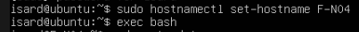

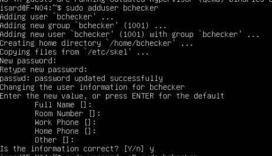

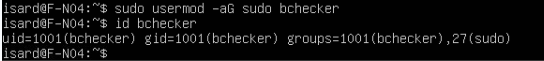

---

## 3. Configuración de red

Durante la instalación, la máquina tiene dos tarjetas: la **Default** de IsardVDI (Internet para instalar paquetes) y la **DMZ** con IP fija.

Archivo `/etc/netplan/01-f-n04.yaml`:

```yaml
network:
  version: 2
  ethernets:
    enp1s0:
      dhcp4: true
    enp2s0:
      addresses:
        - 10.4.10.20/24
      routes:
        - to: 10.4.20.0/24
          via: 10.4.10.1
```

La ruta hace que el tráfico hacia la Intranet (los clientes) pase por el router, y que las respuestas vuelvan por el mismo camino.

```bash
sudo chmod 600 /etc/netplan/01-f-n04.yaml
sudo netplan try
```

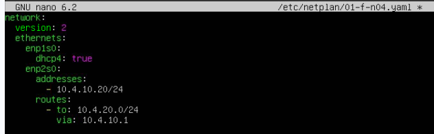

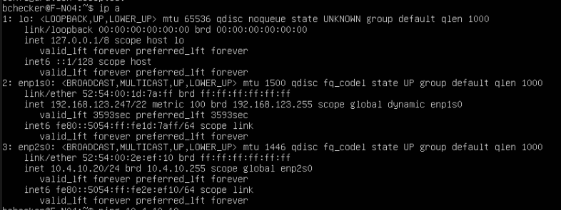

**Comprobación de que está en la DMZ:** el ping a W-N04 (`10.4.10.10`) responde, así que las dos máquinas están en la misma red. (El ping al router no sirve para esto, porque el router contesta desde cualquiera de sus redes.)

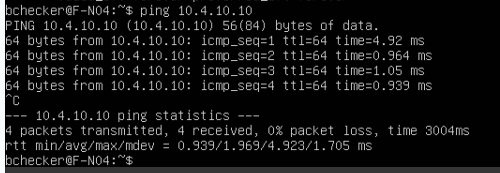

**Configuración final:** después se quita la tarjeta Default y todo el tráfico sale por el router:

```yaml
network:
  version: 2
  ethernets:
    enp1s0:
      addresses:
        - 10.4.10.20/24
      routes:
        - to: default
          via: 10.4.10.1
      nameservers:
        addresses: [10.4.10.1]
```

Al quitar una tarjeta, la que queda puede cambiar de nombre (`enp2s0` → `enp1s0`), así que hay que comprobarlo con `ip a` antes de aplicar.

---

## 4. Instalación de vsftpd

**vsftpd** (*very secure FTP daemon*) es el servidor FTP más habitual en Ubuntu.

```bash
sudo apt install vsftpd
sudo cp /etc/vsftpd.conf /etc/vsftpd.conf.backup
```

La copia del archivo original permite volver atrás si la configuración falla.

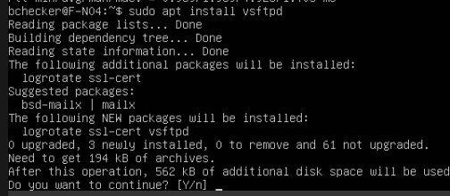

---

## 5. Configuración de vsftpd

Se añade al final de `/etc/vsftpd.conf`:

```
anonymous_enable=NO
local_enable=YES
write_enable=YES
chroot_local_user=YES
allow_writeable_chroot=YES
pasv_min_port=40000
pasv_max_port=40100
userlist_enable=YES
userlist_file=/etc/vsftpd.userlist
userlist_deny=NO
```

| Opción | Qué hace |
|---|---|
| `anonymous_enable=NO` | Nadie entra sin usuario y contraseña |
| `local_enable=YES` | Se entra con usuarios de la máquina |
| `write_enable=YES` | Permite subir archivos |
| `chroot_local_user=YES` | Cada usuario queda encerrado en su carpeta y no ve el resto del servidor |
| `allow_writeable_chroot=YES` | Permite ese encierro aunque la carpeta sea del propio usuario |
| `pasv_min_port` / `pasv_max_port` | Puertos para enviar los datos en modo pasivo |
| `userlist_*` (`deny=NO`) | Solo pueden entrar los usuarios de la lista |

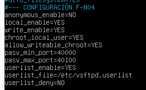

```bash
echo "bchecker" | sudo tee /etc/vsftpd.userlist
sudo systemctl restart vsftpd
systemctl status vsftpd
sudo ss -tlnp | grep :21
```

El servicio está **`enabled`** y **`active (running)`**, y escucha en el **puerto 21**.

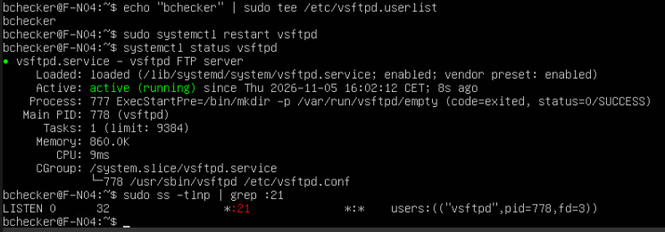

---

## 6. Usuario FTP y permisos

Se crea un usuario **solo para el FTP**: no está en el grupo `sudo`, así que si su contraseña se filtra, solo da acceso a su carpeta.

```bash
sudo adduser usuario_ftp
sudo mkdir /home/usuario_ftp/archivos
sudo chown usuario_ftp:usuario_ftp /home/usuario_ftp/archivos
sudo ls -l /home/usuario_ftp
```

La carpeta `archivos` es donde el usuario sube y descarga.

Sin `sudo`, el `ls` da `Permission denied`: en Ubuntu 22.04 las carpetas personales tienen permisos **750** y otros usuarios no pueden entrar.

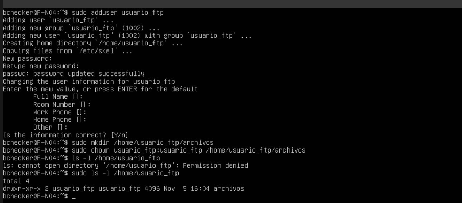

Se añade a la lista de usuarios permitidos (con `-a` para no borrar a `bchecker`):

```bash
echo "usuario_ftp" | sudo tee -a /etc/vsftpd.userlist
sudo systemctl restart vsftpd
```

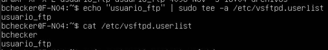

---

## 7. Prueba desde el PC Linux

Desde el PC Linux de la Intranet se instala el cliente FTP:

```bash
sudo apt install ftp
```

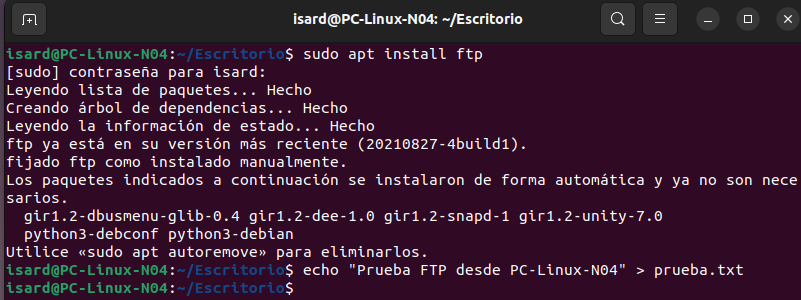

Se crea un archivo y se sube al servidor en **modo pasivo** (`-p`):

```bash
echo "Prueba FTP desde PC-Linux-N04" > prueba.txt
ftp -p 10.4.10.20
```
```
pwd
cd archivos
put prueba.txt
ls
```

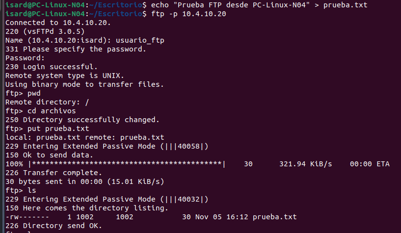

- `230 Login successful` → el usuario puede entrar.
- `pwd` devuelve `/` → el usuario está **encerrado en su carpeta** (chroot).
- `Entering Extended Passive Mode (|||40058|)` → los datos van por un puerto del rango `40000-40100`.
- `226 Transfer complete` → el archivo se ha subido.

**Por qué modo pasivo:** en modo activo, el **servidor** abre la conexión de datos hacia el cliente, y el firewall del router bloquea las conexiones de la DMZ a la Intranet. En modo pasivo, el **cliente** abre las dos conexiones, y la Intranet sí puede llegar a la DMZ.

El archivo ya está en el servidor:

```bash
sudo ls -l /home/usuario_ftp/archivos
```

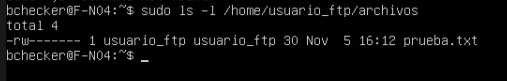

---

## 8. SSH

El enunciado pide SSH en todos los servidores para administrarlos a distancia.

```bash
systemctl status ssh
```

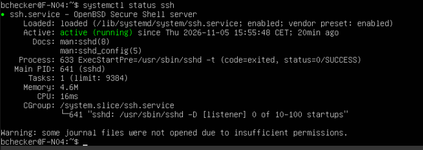

---

## 9. Problemas encontrados y soluciones

| Problema | Causa | Solución |
|---|---|---|
| Al instalar, pregunta qué servicios reiniciar (`dbus`, `systemd-logind`…) | `needrestart` detecta librerías actualizadas | No reiniciar ninguno (`7`) y reiniciar la máquina: reiniciar `dbus` o `logind` puede cerrar la sesión |
| Aviso de kernel nuevo | La actualización instaló otro kernel | `sudo reboot` |
| `ls` de `/home/usuario_ftp` da `Permission denied` | Carpetas personales con permisos 750 | Es una medida de seguridad; usar `sudo ls` |

---

## 10. Resumen de comprobaciones

| Comprobación | Comando | Resultado esperado |
|---|---|---|
| Está en la DMZ | `ping -c 3 10.4.10.10` | Responde W-N04 |
| Servicio activo | `systemctl status vsftpd` | `active (running)` |
| Puerto | `ss -tlnp \| grep :21` | `vsftpd` escuchando |
| Acceso FTP | `ftp -p 10.4.10.20` | `230 Login successful` |
| Encierro en su carpeta | `pwd` dentro del FTP | `/` |
| Subida de archivos | `put prueba.txt` | `226 Transfer complete` |
| SSH | `systemctl status ssh` | `active (running)` |
