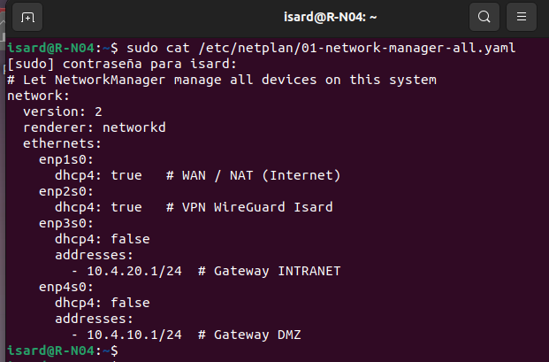
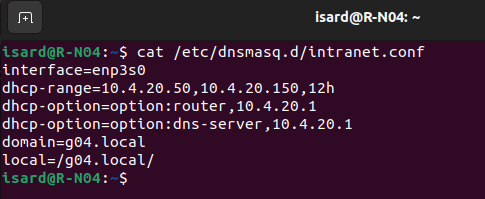
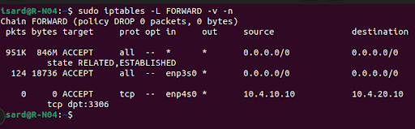

# Router (R-N04)

Router que connecta Internet, la DMZ i la Intranet. Fa de firewall (iptables), NAT, DHCP i DNS (dnsmasq).

**Responsable:** Jordi

## Índex

1. [Dades de la màquina](#1-dades-de-la-màquina)
2. [Configuració de xarxa](#2-configuració-de-xarxa)
3. [DHCP i DNS amb dnsmasq](#3-dhcp-i-dns-amb-dnsmasq)
4. [Usuari obligatori bchecker](#4-usuari-obligatori-bchecker)
5. [Accés remot per SSH](#5-accés-remot-per-ssh)
6. [Encaminament, NAT i firewall](#6-encaminament-nat-i-firewall)
7. [Resum de comprovacions](#7-resum-de-comprovacions)

---

## 1. Dades de la màquina

| Camp | Valor |
|---|---|
| Hostname | `R-N04` (també `R`) |
| Equip / grup | `N04` / `G04` |
| Sistema operatiu | Ubuntu Server 22.04 LTS |
| Serveis | iptables, NAT, dnsmasq (DHCP i DNS), SSH |

---

## 2. Configuració de xarxa

| Interfície | Xarxa | IP |
|---|---|---|
| `enp1s0` | WAN (Default d'Isard) | DHCP d'Isard |
| `enp2s0` | Gestió (WireGuard) | Assignada per la VPN d'Isard |
| `enp3s0` | Intranet | `10.4.20.1/24` |
| `enp4s0` | DMZ | `10.4.10.1/24` |

Les IPs `.1` són les portes d'enllaç dels servidors i clients de cada xarxa.

Fitxer `/etc/netplan/01-network-manager-all.yaml`:

```yaml
network:
  version: 2
  renderer: networkd
  ethernets:
    enp1s0:
      dhcp4: true   # WAN / NAT (Internet)
    enp2s0:
      dhcp4: true   # VPN WireGuard Isard
    enp3s0:
      dhcp4: false
      addresses:
        - 10.4.20.1/24  # Gateway INTRANET
    enp4s0:
      dhcp4: false
      addresses:
        - 10.4.10.1/24  # Gateway DMZ
```




---

## 3. DHCP i DNS amb dnsmasq

dnsmasq reparteix IPs per DHCP i resol els noms de les màquines.

```bash
sudo apt install dnsmasq
```


**Configuració a `/etc/dnsmasq.d/intranet.conf`**

El fitxer principal `/etc/dnsmasq.conf` es deixa amb els valors per defecte (tot comentat). La configuració pròpia va en un fitxer a part dins `/etc/dnsmasq.d/`, que dnsmasq llegeix automàticament:

```
interface=enp3s0
dhcp-range=10.4.20.50,10.4.20.150,12h
dhcp-option=option:router,10.4.20.1
dhcp-option=option:dns-server,10.4.20.1
domain=g04.local
local=/g04.local/
```

| Línia | Què fa |
|---|---|
| `interface=enp3s0` | dnsmasq només atén la Intranet |
| `dhcp-range` | Reparteix IPs de `.50` a `.150`, durant 12 hores |
| `option:router` | Porta d'enllaç que reben els clients |
| `option:dns-server` | DNS que reben els clients (el mateix router) |
| `domain` / `local` | Domini intern `g04.local`, que només es resol localment |




**Noms locals a `/etc/hosts`** (dnsmasq els fa servir per resoldre `R-N04`, `W-N04`, etc.)


```bash
sudo systemctl restart dnsmasq
```

---

## 4. Usuari obligatori bchecker

```bash
sudo adduser bchecker
sudo usermod -aG sudo bchecker
```


---

## 5. Accés remot per SSH

```bash
sudo apt update && sudo apt install -y openssh-server
sudo systemctl enable --now ssh
sudo ss -tulpn | grep :22
```

Ha d'aparèixer `sshd` escoltant al port 22.


---

## 6. Encaminament, NAT i firewall

### 6.1 IP forwarding

Linux no reenvia paquets entre xarxes per defecte. A `/etc/sysctl.conf`:

```
net.ipv4.ip_forward = 1
```

```bash
sudo sysctl -p
```


### 6.2 NAT i firewall

```bash
# Netejar regles prèvies
sudo iptables -F
sudo iptables -t nat -F

# Per defecte, es bloqueja el tràfic entre xarxes
sudo iptables -P FORWARD DROP

# NAT: les xarxes internes surten a Internet amb la IP del router
sudo iptables -t nat -A POSTROUTING -o enp1s0 -j MASQUERADE

# Deixar passar les respostes de connexions establertes
sudo iptables -A FORWARD -m state --state RELATED,ESTABLISHED -j ACCEPT

# La Intranet pot anar a Internet i a la DMZ
sudo iptables -A FORWARD -i enp3s0 -j ACCEPT

# DMZ -> Intranet: només el web cap a la BBDD pel port 3306
sudo iptables -A FORWARD -i enp4s0 -s 10.4.10.10 -d 10.4.20.10 -p tcp --dport 3306 -j ACCEPT
```

**Comprovació de les regles:**

```bash
sudo iptables -L FORWARD -v -n
```



- `policy DROP`: tot el que no coincideix amb cap regla es bloqueja.
- `RELATED,ESTABLISHED`: deixa passar les respostes de les connexions ja obertes.
- `enp3s0`: la Intranet pot sortir a qualsevol lloc.
- `enp4s0` → `10.4.20.10` port `3306`: l'únic pas obert de la DMZ cap a la Intranet.

Les columnes `pkts` i `bytes` compten els paquets que han coincidit amb cada regla des de l'última vegada que es van carregar.

---

## 7. Resum de comprovacions

| Comprovació | Comanda | Resultat esperat |
|---|---|---|
| Interfícies | `ip a` | 4 interfícies amb IP |
| dnsmasq | `systemctl status dnsmasq` | `active (running)` |
| DNS | `nslookup R-N04 10.4.20.1` | IP del router |
| SSH | `ss -tulpn \| grep :22` | `sshd` escoltant |
| Forwarding | `sysctl net.ipv4.ip_forward` | `= 1` |
| Firewall | `iptables -L FORWARD -v -n` | Política `DROP` i regles |
