# Servidor de base de datos (B-N04)

Servidor MariaDB situado en la **Intranet**. Guarda los datos de la aplicación (base de datos `crud_db`) y solo acepta conexiones remotas de los usuarios creados para ello.

**Responsable:** Mario

## Índice

1. [Datos de la máquina](#1-datos-de-la-máquina)
2. [Configuración de red](#2-configuración-de-red)
3. [Instalación de MariaDB](#3-instalación-de-mariadb)
4. [Nombre de la máquina](#4-nombre-de-la-máquina)
5. [Usuario obligatorio bchecker](#5-usuario-obligatorio-bchecker)
6. [Permitir conexiones remotas](#6-permitir-conexiones-remotas)
7. [Seguridad del motor](#7-seguridad-del-motor-mysql_secure_installation)
8. [Base de datos y usuarios remotos](#8-base-de-datos-y-usuarios-remotos)
9. [Resumen de comprobaciones](#9-resumen-de-comprobaciones)

---

## 1. Datos de la máquina

| Campo | Valor |
|---|---|
| Hostname | B-N04 |
| Sistema operativo | Ubuntu 22.04 LTS |
| Motor de BBDD | MariaDB 10.6.23 |
| Red | Intranet (10.4.20.0/24) |
| Interfaz | `enp3s0` |
| IP | `10.4.20.10/24` (fija) |
| Puerta de enlace | `10.4.20.1` (router R-N04) |
| Puerto del servicio | 3306/TCP |

---

## 2. Configuración de red

El servidor tiene **IP fija** para que el servidor web y el DNS siempre lo encuentren en la misma dirección. Se configura con netplan en `/etc/netplan/01-netcfg.yaml`:

```yaml
network:
  version: 2
  renderer: networkd
  ethernets:
    enp3s0:
      dhcp4: no
      addresses:
        - 10.4.20.10/24
      routes:
        - to: default
          via: 10.4.20.1
      nameservers:
        addresses:
          - 8.8.8.8
```

- `dhcp4: no` → no pide IP al DHCP, usa la fija.
- `routes: default via 10.4.20.1` → todo lo que no sea de la Intranet sale por el router.
- `nameservers` → servidor DNS que usa la máquina.

```bash
sudo netplan apply
```

La máquina solo tiene la tarjeta de la Intranet: sale a Internet a través del router (NAT).

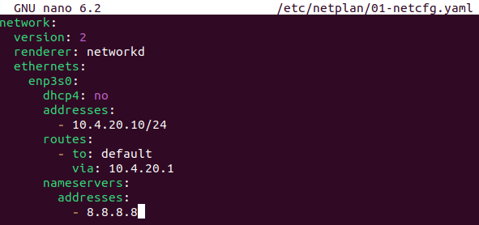

---

## 3. Instalación de MariaDB

Se usa **MariaDB**, una versión libre y compatible con MySQL: los comandos, el puerto (3306) y la forma de conectarse desde PHP son los mismos.

```bash
sudo apt install mariadb-server mariadb-client git net-tools -y
```

| Paquete | Para qué sirve |
|---|---|
| `mariadb-server` | El motor de base de datos |
| `mariadb-client` | El comando `mysql` para administrarla |
| `git` | Descargar el repositorio del proyecto |
| `net-tools` | Herramientas de red para comprobaciones |

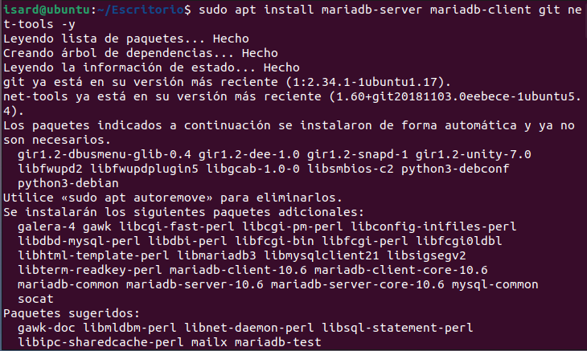

Se comprueba que el servicio está habilitado (arranca solo al encender la máquina) y en ejecución:

```bash
sudo systemctl status mariadb
```

Tiene que aparecer **`enabled`** y **`active (running)`**.

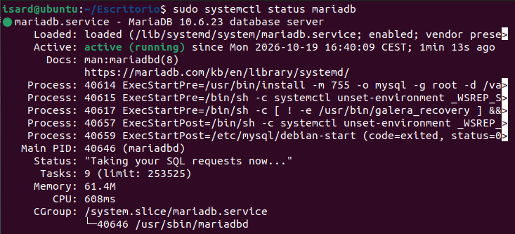

---

## 4. Nombre de la máquina

El enunciado exige el nombre `B-NCC`.

```bash
sudo hostnamectl set-hostname B-N04
hostname
```

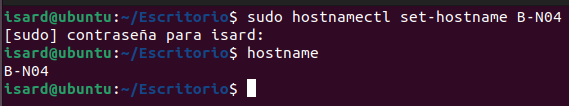

Al abrir una nueva terminal, el prompt ya muestra el nombre nuevo:

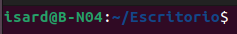

---

## 5. Usuario obligatorio bchecker

El enunciado pide un usuario `bchecker` (contraseña `bchecker121`) en todos los equipos, para que el profesorado pueda revisarlos.

```bash
sudo adduser bchecker
sudo usermod -aG sudo bchecker
```

- `adduser` crea el usuario con su carpeta personal.
- `usermod -aG sudo` lo añade al grupo `sudo` para que tenga permisos de administrador. La `-a` es importante: añade el grupo sin quitarle los que ya tenía.

Durante la creación, el sistema avisa de que la contraseña es débil porque contiene el nombre del usuario. Al repetirla, la acepta igualmente.

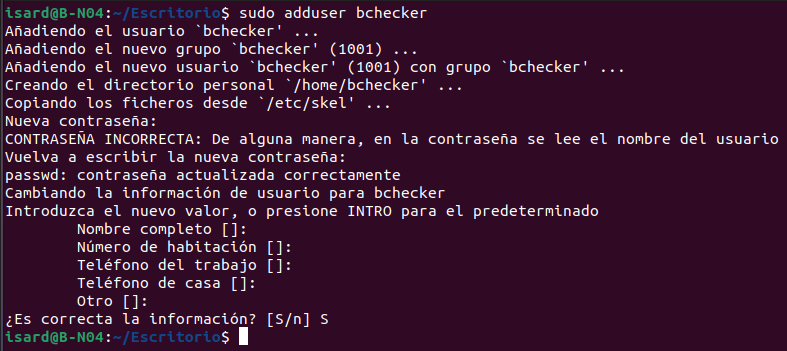

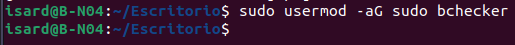

---

## 6. Permitir conexiones remotas

Por defecto, MariaDB solo escucha en `127.0.0.1` (la propia máquina). Como la aplicación web está en **otro servidor** (W-N04, en la DMZ), hay que permitir conexiones desde la red.

Archivo: `/etc/mysql/mariadb.conf.d/50-server.cnf`

| Antes | Después |
|---|---|
| `bind-address = 127.0.0.1` | `bind-address = 0.0.0.0` |

`0.0.0.0` significa "escuchar en todas las interfaces de red".

**Antes:**

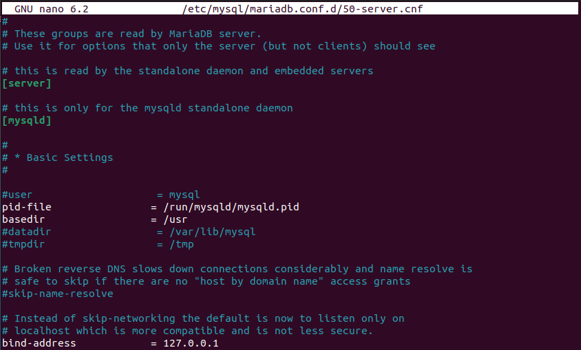

**Después:**

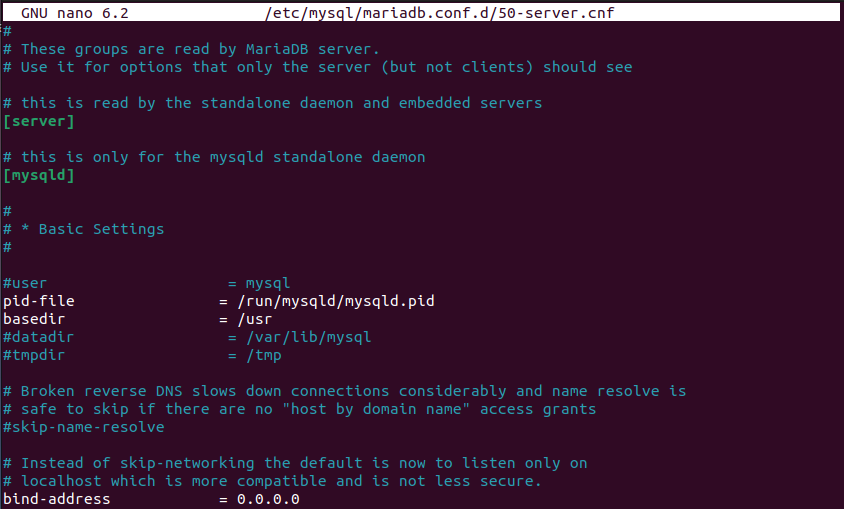

Se reinicia el servicio para aplicar el cambio y se comprueba en qué dirección escucha:

```bash
sudo systemctl restart mariadb
sudo ss -tlnp | grep 3306
```

`ss -tlnp` muestra los puertos **T**CP en escucha (**l**isten), en formato **n**umérico y con el **p**roceso que los usa. El resultado `0.0.0.0:3306` confirma que MariaDB ya acepta conexiones remotas.

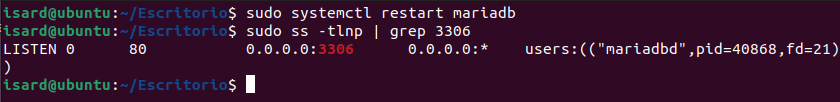

> **Seguridad:** abrir el puerto en todas las interfaces no significa que cualquiera pueda entrar. El router solo deja pasar el puerto 3306 desde el servidor web (W-N04), y además MariaDB pide usuario y contraseña.

---

## 7. Seguridad del motor (mysql_secure_installation)

Script que viene con MariaDB para quitar la configuración "de pruebas" que trae por defecto.

```bash
sudo mysql_secure_installation
```

| Pregunta | Respuesta | Por qué |
|---|---|---|
| Switch to unix_socket authentication | n | root ya estaba protegido |
| Change the root password | n | root ya estaba protegido |
| Remove anonymous users | Y | Evita que alguien entre sin usuario |
| Disallow root login remotely | Y | root solo puede entrar desde la propia máquina |
| Remove test database | Y | Base de datos de pruebas accesible por cualquiera |
| Reload privilege tables | Y | Aplica los cambios al momento |

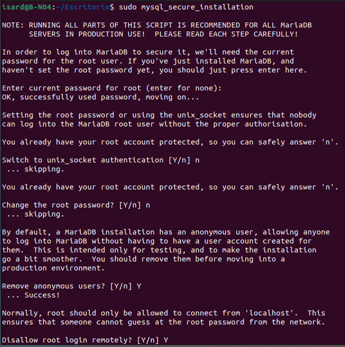

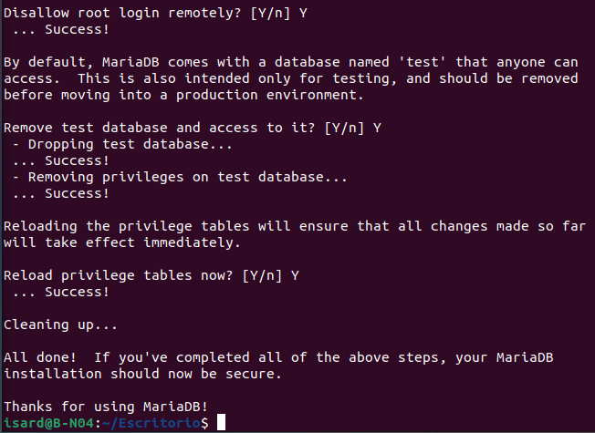

---

## 8. Base de datos y usuarios remotos

Se entra en MariaDB como administrador:

```bash
sudo mysql -u root
```

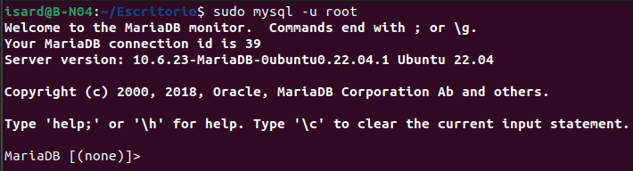

Se crea la base de datos **`crud_db`** con codificación **`utf8mb4`**, que admite todos los caracteres (acentos, `ç`, `ñ`…). Es necesaria porque los datos de Open Data BCN tienen nombres en catalán. Después se crean los usuarios remotos y se les dan permisos:

```sql
CREATE DATABASE crud_db CHARACTER SET utf8mb4 COLLATE utf8mb4_unicode_ci;

CREATE USER 'usuario_app'@'%' IDENTIFIED BY '********';
GRANT ALL PRIVILEGES ON crud_db.* TO 'usuario_app'@'%';

CREATE USER 'bchecker'@'%' IDENTIFIED BY 'bchecker121';
GRANT ALL PRIVILEGES ON *.* TO 'bchecker'@'%' WITH GRANT OPTION;

FLUSH PRIVILEGES;
EXIT;
```

| Usuario | Desde dónde | Permisos | Para qué |
|---|---|---|---|
| `usuario_app` | `%` (cualquier equipo) | Solo sobre `crud_db` | Lo usa la aplicación del servidor web |
| `bchecker` | `%` (cualquier equipo) | Todas las bases de datos | Revisión por parte del profesorado |

- `'usuario'@'%'` → el `%` indica que el usuario puede conectarse desde cualquier IP.
- `crud_db.*` → todas las tablas de esa base de datos, y ninguna más.
- `FLUSH PRIVILEGES` → recarga los permisos para que se apliquen.

> La contraseña de `usuario_app` no se publica porque el repositorio es público. Se ha difuminado en la captura.

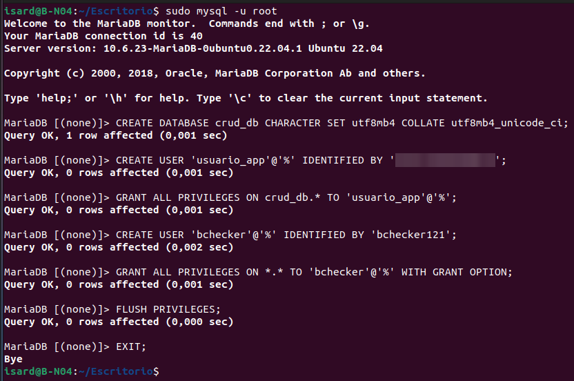

Comprobación final de que MariaDB sigue escuchando en el puerto 3306:

```bash
sudo ss -tlnp | grep mariadb
```

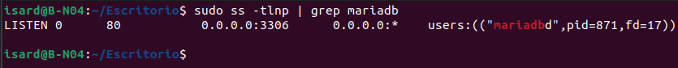

---

## 9. Resumen de comprobaciones

| Comprobación | Comando | Resultado esperado |
|---|---|---|
| Servicio activo | `systemctl status mariadb` | `active (running)` |
| Escucha en red | `ss -tlnp \| grep 3306` | `0.0.0.0:3306` |
| Seguridad aplicada | `mysql_secure_installation` | `All done!` |
| Hostname | `hostname` | `B-N04` |
| BBDD y usuarios | `CREATE DATABASE` / `CREATE USER` | `Query OK` |
