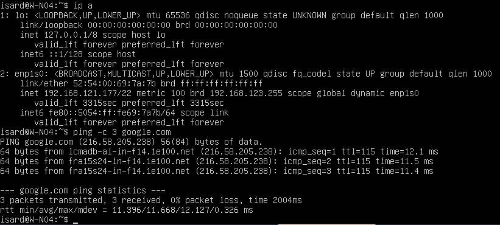
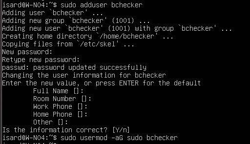
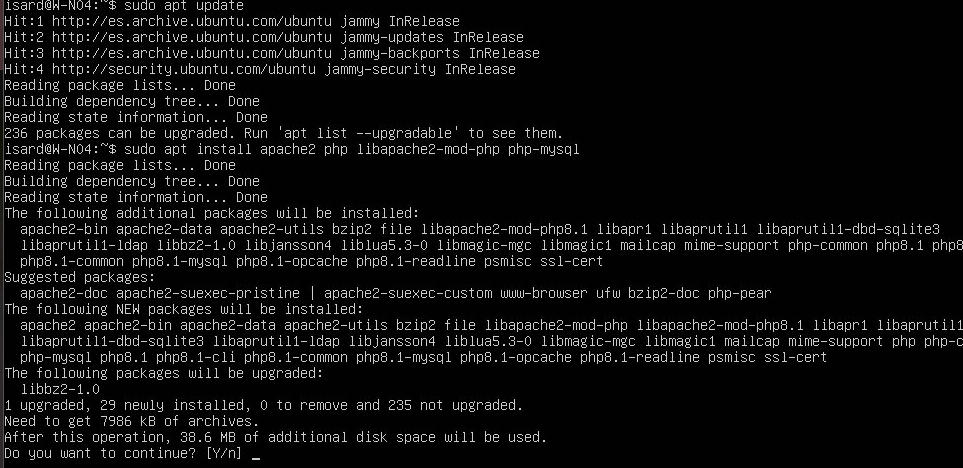
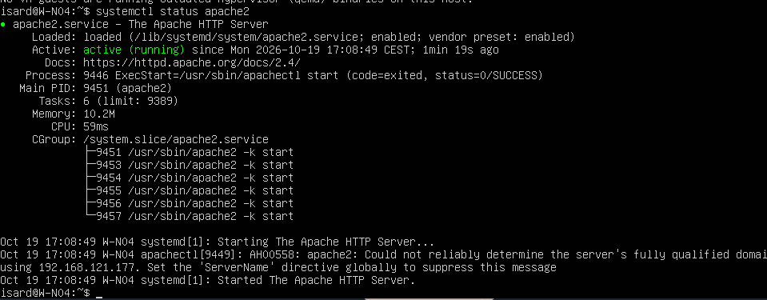
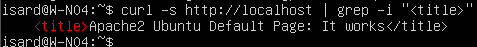
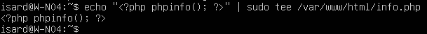
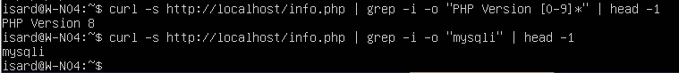
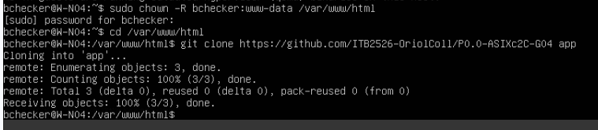
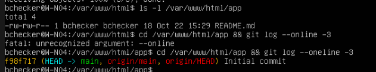
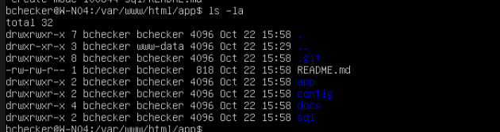

# Servidor web (W-N04)

Servidor Apache con PHP situado en la **DMZ**. Sirve la aplicación web que muestra los datos de Open Data BCN guardados en el servidor de base de datos (B-N04). El código se despliega desde el repositorio de GitHub con `git clone` y `git pull`.

**Responsable:** Oriol Coll Llorens

## Índice

1. [Datos de la máquina](#1-datos-de-la-máquina)
2. [Creación de la máquina y comprobación de red](#2-creación-de-la-máquina-y-comprobación-de-red)
3. [Usuario obligatorio bchecker](#3-usuario-obligatorio-bchecker)
4. [Instalación de Apache y PHP](#4-instalación-de-apache-y-php)
5. [Verificación de Apache y PHP](#5-verificación-de-apache-y-php)
6. [Despliegue del repositorio con git](#6-despliegue-del-repositorio-con-git)
7. [Problemas encontrados y soluciones](#7-problemas-encontrados-y-soluciones)
8. [Resumen de comprobaciones](#8-resumen-de-comprobaciones)

---

## 1. Datos de la máquina

| Campo | Valor |
|---|---|
| Hostname | W-N04 |
| Sistema operativo | Ubuntu Server 22.04.4 LTS (plantilla mínima de IsardVDI) |
| Servidor web | Apache 2.4 |
| Lenguaje | PHP 8.1 |
| Interfaz | `enp1s0` |
| Puertos del servicio | 80/TCP (web), 22/TCP (SSH) |
| Ruta de la aplicación | `/var/www/html/app` |

**Red**

| Fase | Red | IP |
|---|---|---|
| Sprint 1 (instalación) | Default de IsardVDI (NAT) | `192.168.121.177/22` por DHCP |
| Final | DMZ (10.4.10.0/24) | `10.4.10.10/24` fija, puerta de enlace `10.4.10.1` |

Durante la instalación la máquina usa la red **Default** de IsardVDI para tener salida a Internet y descargar paquetes. Cuando el router R-N04 esté operativo, se mueve a la **DMZ** con IP fija y sale a Internet a través del router.

---

## 2. Creación de la máquina y comprobación de red

Se crea un escritorio en IsardVDI con la plantilla de **Ubuntu Server 22.04** y la red **Default**. Después se cambia el nombre de la máquina, que lo exige el enunciado (`W-NCC`):

```bash
sudo hostnamectl set-hostname W-N04
exec bash
```

`exec bash` abre una nueva terminal para que el prompt muestre el nombre nuevo sin cerrar sesión.

La plantilla es **mínima** y no trae herramientas básicas, así que se instalan:

```bash
sudo apt update
sudo apt install nano iputils-ping
```

| Paquete | Para qué sirve |
|---|---|
| `nano` | Editor de texto para modificar archivos de configuración |
| `iputils-ping` | Comando `ping` para comprobar la conectividad |

Se comprueba la red:

```bash
ip a
ping -c 3 google.com
```

- `ip a` muestra la interfaz `enp1s0` con la IP `192.168.121.177`, asignada por el DHCP de IsardVDI.
- El `ping` a `google.com` responde, así que la máquina tiene Internet y resuelve nombres (DNS).



---

## 3. Usuario obligatorio bchecker

El enunciado pide un usuario `bchecker` (contraseña `bchecker121`) en todos los equipos, para que el profesorado pueda revisarlos.

```bash
sudo adduser bchecker
sudo usermod -aG sudo bchecker
```

- `adduser` crea el usuario, su grupo y su carpeta personal (`/home/bchecker`).
- `usermod -aG sudo` lo añade al grupo `sudo` para que tenga permisos de administrador. La `-a` añade el grupo sin quitarle los que ya tenía.



Para comprobarlo:

```bash
id bchecker
```

En la lista de grupos tiene que aparecer `sudo`.

---

## 4. Instalación de Apache y PHP

```bash
sudo apt update
sudo apt install apache2 php libapache2-mod-php php-mysql
```

| Paquete | Para qué sirve |
|---|---|
| `apache2` | Servidor web: recibe las peticiones del navegador y devuelve las páginas |
| `php` | Intérprete que ejecuta el código PHP de la aplicación |
| `libapache2-mod-php` | Módulo que conecta Apache con PHP, para que ejecute los `.php` en vez de mostrarlos como texto |
| `php-mysql` | Extensión que permite a PHP conectarse a MySQL/MariaDB (la base de datos de B-N04) |

Se instala PHP **8.1**, la versión de Ubuntu 22.04.



Al acabar, el sistema pregunta qué servicios reiniciar porque algunas librerías se han actualizado. Se reinician los tres (`1 2 3`): son servicios internos y no afecta a nada.

Se comprueba que Apache está habilitado y en ejecución:

```bash
systemctl status apache2
```

Tiene que aparecer **`enabled`** (arranca solo al encender la máquina) y **`active (running)`**.



> **Aviso AH00558:** Apache avisa de que no sabe el nombre completo del servidor y usa la IP. No es un error; el servicio funciona igual. Se puede quitar el aviso añadiendo `ServerName W-N04` al final de `/etc/apache2/apache2.conf` y reiniciando con `sudo systemctl restart apache2`.

---

## 5. Verificación de Apache y PHP

La máquina no tiene entorno gráfico y está detrás del NAT de IsardVDI, así que la comprobación se hace desde la propia máquina con **`curl`**, que pide la página igual que un navegador.

**Página por defecto de Apache**

```bash
curl -s http://localhost | grep -i "<title>"
```

Devuelve `Apache2 Ubuntu Default Page: It works`, así que Apache sirve páginas.



**Página de prueba de PHP**

Se crea `info.php`, que muestra toda la configuración de PHP:

```bash
echo "<?php phpinfo(); ?>" | sudo tee /var/www/html/info.php
```



Se comprueba que PHP se ejecuta y que tiene el módulo de MySQL:

```bash
curl -s http://localhost/info.php | grep -i -o "PHP Version [0-9]*" | head -1
curl -s http://localhost/info.php | grep -i -o "mysqli" | head -1
```

- Sale `PHP Version 8`: Apache **ejecuta** el código PHP (si no, devolvería el texto `<?php phpinfo(); ?>`).
- Sale `mysqli`: la aplicación podrá conectarse a la base de datos.



**Eliminar info.php**

<!-- TODO Oriol: hacer el rm y añadir captura -->

```bash
sudo rm /var/www/html/info.php
```

`info.php` muestra información interna del servidor (versiones, rutas, módulos) que un atacante podría usar. Solo se usa para la prueba y después se borra.

---

## 6. Despliegue del repositorio con git

Todo el código y la documentación del proyecto están en GitHub:
[ITB2526-OriolColl/P0.0-ASIXc2C-G04](https://github.com/ITB2526-OriolColl/P0.0-ASIXc2C-G04)

El servidor web **descarga** el repositorio; los cambios se hacen en GitHub (o en el PC) y el servidor se actualiza con `git pull`. Así, lo que hay en producción es siempre lo que está en el repositorio.

**Permisos de la carpeta web**

```bash
sudo chown -R bchecker:www-data /var/www/html
```

`/var/www/html` pertenece a root. Con este cambio, el usuario puede clonar y actualizar sin `sudo`, y Apache (que funciona con el usuario `www-data`) puede leer los archivos.

**Clonar el repositorio**

```bash
cd /var/www/html
git clone https://github.com/ITB2526-OriolColl/P0.0-ASIXc2C-G04 app
```

El repositorio se clona en la carpeta `app`, para no mezclarlo con la página por defecto de Apache. Queda accesible en `http://<IP>/app`.



Se comprueba el contenido y el último commit:

```bash
ls -l /var/www/html/app
cd /var/www/html/app && git log --oneline -3
```

En ese momento el repositorio solo tenía el `README.md` del commit inicial.



**Actualizar desde GitHub (subida a producción)**

Después de crear en GitHub la estructura de carpetas del proyecto, el servidor la descarga:

```bash
cd /var/www/html/app
git pull
ls -la
```

Aparecen las carpetas `app`, `config`, `docs` y `sql`. Este es el flujo de despliegue del proyecto: **cambio en GitHub → `git pull` en el servidor**.



---

## 7. Problemas encontrados y soluciones

| Problema | Causa | Solución |
|---|---|---|
| `nano` y `ping` no existen | La plantilla de IsardVDI es mínima | `sudo apt install nano iputils-ping` |
| El prompt no muestra el nombre nuevo tras `hostnamectl` | El prompt se genera al abrir la terminal | `exec bash` o volver a iniciar sesión |
| Error `404 Not Found` al instalar `git` | Lista de paquetes desactualizada: pedía una versión que ya no existe | `sudo apt update` y volver a instalar |
| Pregunta de reinicio de servicios tras instalar Apache | `needrestart` detecta servicios con librerías antiguas | Reiniciarlos (`1 2 3`) |
| Aviso AH00558 en Apache | Falta la directiva `ServerName` | No afecta; se quita con `ServerName W-N04` |
| `git log --online` da error | Error de escritura | La opción correcta es `--oneline` |

---

## 8. Resumen de comprobaciones

| Comprobación | Comando | Resultado esperado |
|---|---|---|
| Red e Internet | `ping -c 3 google.com` | 3 respuestas, 0 % de pérdida |
| Usuario bchecker | `id bchecker` | Grupo `sudo` en la lista |
| Apache activo | `systemctl status apache2` | `active (running)` |
| Apache sirve páginas | `curl -s http://localhost` | `It works` |
| PHP con MySQL | `curl -s http://localhost/info.php` | `PHP Version 8` y `mysqli` |
| Repositorio desplegado | `git log --oneline` | Último commit de `main` |
