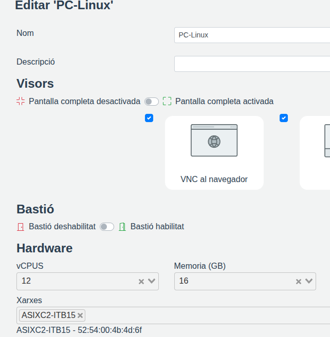
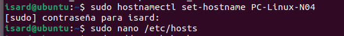
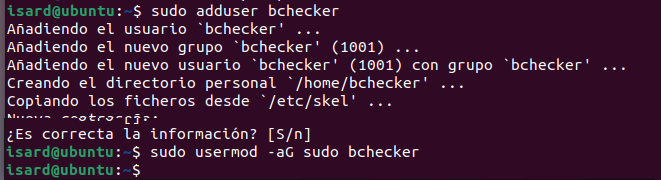
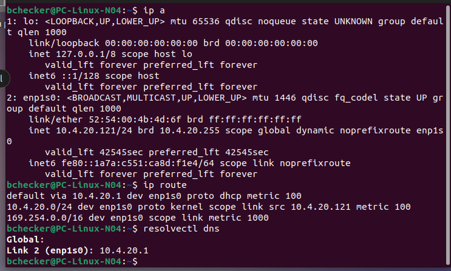
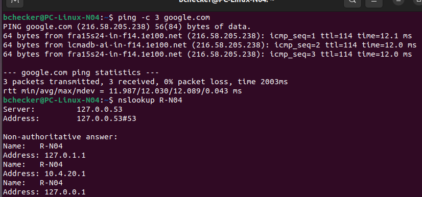

# Clientes

Equipos de usuario de la **Intranet**. No tienen nada configurado a mano: reciben IP, puerta de enlace y DNS del DHCP del router, como los ordenadores de una oficina.

## Índice

1. [PC Linux](#1-pc-linux)
2. [PC Windows](#2-pc-windows)

---

## 1. PC Linux

**Responsable:** Oriol Coll Llorens

### 1.1 Máquina

| Campo | Valor |
|---|---|
| Hostname | `PC-Linux-N04` |
| Sistema operativo | Ubuntu Desktop |
| Red | Intranet (solo esta tarjeta, sin Default) |
| IP | Por DHCP (`10.4.20.121` en las pruebas) |

Sin tarjeta Default: el PC sale a Internet a través del router, como un equipo de la empresa.



### 1.2 Hostname y usuario bchecker

```bash
sudo hostnamectl set-hostname PC-Linux-N04
sudo nano /etc/hosts        # 127.0.1.1 PC-Linux-N04
sudo adduser bchecker
sudo usermod -aG sudo bchecker
```





### 1.3 Red por DHCP

```bash
ip a
ip route
resolvectl dns
```

| Dato | Valor recibido por DHCP |
|---|---|
| IP | `10.4.20.121/24` |
| Puerta de enlace | `10.4.20.1` (R-N04) |
| DNS | `10.4.20.1` (R-N04) |



### 1.4 Internet y DNS

```bash
ping -c 3 google.com
nslookup R-N04
```

- El `ping` responde: el PC sale a Internet por el router (NAT).
- `nslookup` resuelve `R-N04` a `10.4.20.1` con el DNS del router.



**Problema:** al principio `nslookup R-N04` daba `SERVFAIL`. Ubuntu pregunta primero a `systemd-resolved` (`127.0.0.53`), que por defecto no reenvía al DNS los nombres sin dominio (`R-N04` en vez de `R-N04.algo`).

**Solución:** en `/etc/systemd/resolved.conf`, sección `[Resolve]`:

```
ResolveUnicastSingleLabel=yes
```

```bash
sudo systemctl restart systemd-resolved
```

### 1.5 Acceso a la aplicación

Desde Firefox, `http://W-N04/app/app/` muestra la aplicación con los datos de la base de datos. Prueba todo el camino: DNS → router → servidor web (DMZ) → router → base de datos (Intranet). Ver [04-servidor-web.md](04-servidor-web.md#8-aplicación-web).

---

## 2. PC Windows

**Responsable:** Jordi


### 1.1 Máquina

| Campo | Valor |
|---|---|
| Hostname | `PC-W11-N04` |
| Sistema operativo | Windows 11 |
| Red | Intranet (solo esta tarjeta, sin Default) |
| IP | Por DHCP (`10.4.20.93` en las pruebas) |

Sin tarjeta Default: el PC sale a Internet a través del router, como un equipo de la empresa.

---
