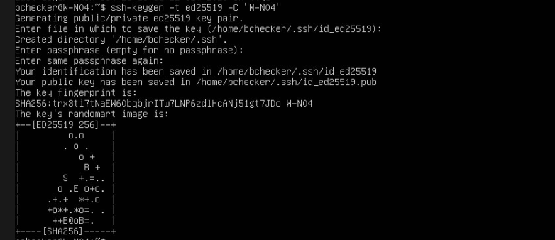
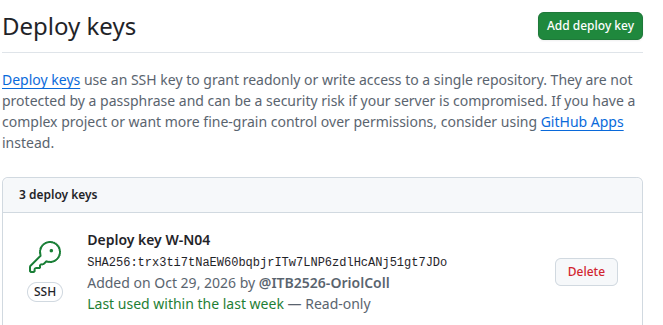
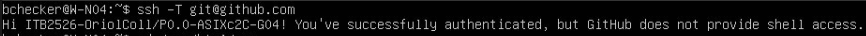
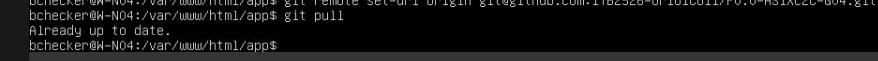
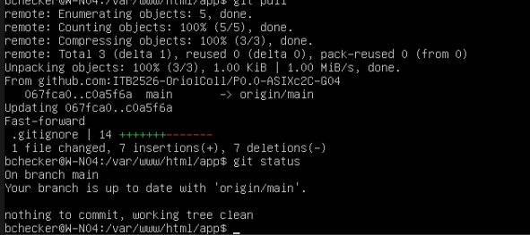

# Git y despliegue a producción

Todo el código, la configuración y la documentación del proyecto están en un repositorio de GitHub. El servidor web (W-N04) descarga el código del repositorio y se autentica con **clave pública/privada (SSH)**.

**Responsable:** Oriol Coll Llorens

## Índice

1. [Repositorio](#1-repositorio)
2. [Clave SSH del servidor](#2-clave-ssh-del-servidor)
3. [Despliegue en el servidor web](#3-despliegue-en-el-servidor-web)
4. [Flujo de trabajo](#4-flujo-de-trabajo)
5. [Datos privados fuera del repositorio](#5-datos-privados-fuera-del-repositorio)
6. [Problemas encontrados y soluciones](#6-problemas-encontrados-y-soluciones)

---

## 1. Repositorio

| Campo | Valor |
|---|---|
| Nombre | `P0.0-ASIXc2C-G04` |
| URL | [github.com/ITB2526-OriolColl/P0.0-ASIXc2C-G04](https://github.com/ITB2526-OriolColl/P0.0-ASIXc2C-G04) |
| Visibilidad | Público |
| Colaboradores | Oriol, Mario y Jordi (permisos de escritura) |
| Rama | `main` |

| Carpeta | Contenido |
|---|---|
| `docs/` | Documentación en Markdown (y `docs/img/` con las capturas) |
| `app/` | Aplicación web PHP |
| `config/` | Copias de los archivos de configuración |
| `sql/` | Scripts de la base de datos |

---

## 2. Clave SSH del servidor

El servidor web se conecta a GitHub con una **deploy key**: una clave SSH que solo da acceso a este repositorio.

**Generar la clave** (usuario `bchecker`, que es el propietario del repositorio en el servidor):

```bash
ssh-keygen -t ed25519 -C "W-N04"
```

Se crean dos archivos: la clave **privada** (`~/.ssh/id_ed25519`), que nunca sale del servidor, y la **pública** (`~/.ssh/id_ed25519.pub`), que se da a GitHub.



```bash
cat ~/.ssh/id_ed25519.pub
```


**Añadirla a GitHub:** repositorio → *Settings → Deploy keys → Add deploy key*, **sin** permiso de escritura (*Read-only*).

Solo lectura porque el servidor únicamente necesita descargar código. Si alguien lo comprometiera, no podría modificar el repositorio.



**Comprobar la autenticación:**

```bash
ssh -T git@github.com
```

La primera vez, SSH pide confirmar la huella de GitHub (se responde `yes`). Después responde con el nombre del repositorio.



---

## 3. Despliegue en el servidor web

**Primer despliegue (clonar):**

```bash
sudo chown -R bchecker:www-data /var/www/html
cd /var/www/html
git clone https://github.com/ITB2526-OriolColl/P0.0-ASIXc2C-G04 app
```

- `chown` → el usuario puede clonar y actualizar sin `sudo`, y Apache (`www-data`) puede leer los archivos.
- El repositorio queda en `/var/www/html/app` y la aplicación en `http://W-N04/app/app/`.

**Cambiar a SSH:** el repositorio se clonó por HTTPS antes de tener la clave. Para que use la clave, se cambia la dirección:

```bash
git remote set-url origin git@github.com:ITB2526-OriolColl/P0.0-ASIXc2C-G04.git
git remote -v
```

**Actualizar producción:**

```bash
cd /var/www/html/app
git pull
```



---

## 4. Flujo de trabajo

```
Cambios (PC o web de GitHub)  →  GitHub  →  git pull en W-N04  →  producción
```

| Comando | Para qué sirve |
|---|---|
| `git clone <url>` | Descargar el repositorio por primera vez |
| `git status` | Ver qué archivos han cambiado |
| `git add <archivo>` | Preparar un cambio para guardarlo |
| `git commit -m "mensaje"` | Guardar los cambios preparados en el historial |
| `git push` | Subir los commits a GitHub |
| `git pull` | Descargar los cambios de GitHub (subida a producción) |
| `git log --oneline` | Ver el historial de commits |

Los cambios **nunca se hacen directamente en el servidor**: se suben a GitHub y el servidor los descarga. Así, lo que hay en producción es siempre lo que está en el repositorio.

Los mensajes de commit indican la parte del proyecto: `[web] ...`, `[bbdd] ...`, `[docs] ...`.

---

## 5. Datos privados fuera del repositorio

El repositorio es público, así que las contraseñas no se suben. La aplicación lee la conexión a la base de datos de `app/config.php`:

- En el repositorio solo está `app/config.example.php`, sin contraseña.
- En el servidor se crea la copia real: `cp app/config.example.php app/config.php`.
- El archivo `.gitignore` hace que git ignore `config.php` y las claves SSH:

```
app/config.php
*.pem
id_rsa
id_ed25519
.DS_Store
Thumbs.db
*.swp
```

Con `config.php` creado, `git status` sigue sin cambios pendientes:



---

## 6. Problemas encontrados y soluciones

| Problema | Causa | Solución |
|---|---|---|
| `404 Not Found` al instalar `git` | Lista de paquetes desactualizada | `sudo apt update` y volver a instalar |
| `Host key verification failed` | No se confirmó la huella de GitHub | Repetir `ssh -T` y responder `yes` |
| La deploy key aparecía como *Never used* | El remote seguía siendo HTTPS | `git remote set-url origin git@github.com:...` |
| `ERROR: Repository not found` | Dirección escrita a mano con una `O` en lugar de un `0` | Volver a escribir la dirección exacta (botón *Code → SSH* de GitHub) |
| `config.php` aparecía en `git status` | Las líneas del `.gitignore` empezaban con espacios | Quitar los espacios del principio de cada línea |
