# Pruebas

Pruebas que validan la infraestructura completa: red, servicios, seguridad entre zonas y aplicación. Todas se han hecho desde las máquinas reales del proyecto, con captura como evidencia.

## Índice

1. [Resumen](#1-resumen)
2. [Red: DHCP, DNS e Internet](#2-red-dhcp-dns-e-internet)
3. [Servicios](#3-servicios)
4. [Seguridad entre zonas](#4-seguridad-entre-zonas)
5. [Prueba completa: cliente → web → base de datos](#5-prueba-completa-cliente--web--base-de-datos)

---

## 1. Resumen

| # | Prueba | Desde | Resultado esperado | Resultado |
|---|---|---|---|---|
| 1 | El cliente recibe IP por DHCP | PC Linux, PC Windows | IP `10.4.20.x`, puerta de enlace `10.4.20.1` | ✅ |
| 2 | El DNS resuelve los nombres | PC Linux, PC Windows | `R-N04` → `10.4.20.1` | ✅ |
| 3 | Salida a Internet por el router | PC Linux, B-N04 | `ping` a Internet responde | ✅ |
| 4 | W-N04 está en la DMZ | R-N04 (`tcpdump`) | Tráfico por `enp4s0` | ✅ |
| 5 | F-N04 está en la DMZ | F-N04 | `ping` a W-N04 responde | ✅ |
| 6 | Servidor web activo | W-N04 | Apache `active (running)` | ✅ |
| 7 | Base de datos activa | B-N04 | MariaDB en `0.0.0.0:3306` | ✅ |
| 8 | FTP: acceso y subida | PC Linux → F-N04 | `230 Login successful`, `226 Transfer complete` | ✅ |
| 9 | FTP: usuario encerrado en su carpeta | PC Linux → F-N04 | `pwd` devuelve `/` | ✅ |
| 10 | SSH con `bchecker` | Router, Intranet | Acceso correcto | ✅ |
| 11 | Web → BBDD por el puerto 3306 | W-N04 → B-N04 | `succeeded` | ✅ |
| 12 | DMZ → Intranet por otro puerto | W-N04 → B-N04 (22) | `timed out` (bloqueado) | ✅ |
| 13 | `usuario_app` solo desde W-N04 | B-N04 | Usuario `'usuario_app'@'10.4.10.10'` | ✅ |
| 14 | Aplicación con datos | PC Linux, PC Windows | Tabla con 2709 registros | ✅ |

---

## 2. Red: DHCP, DNS e Internet

**Prueba 1 · DHCP**

Los clientes no tienen nada configurado a mano: reciben IP, puerta de enlace y DNS del router.

| Cliente | IP recibida | Puerta de enlace | DNS |
|---|---|---|---|
| PC Linux | `10.4.20.121` | `10.4.20.1` | `10.4.20.1` |
| PC Windows | `10.4.20.93` | `10.4.20.1` | `10.4.20.1` |

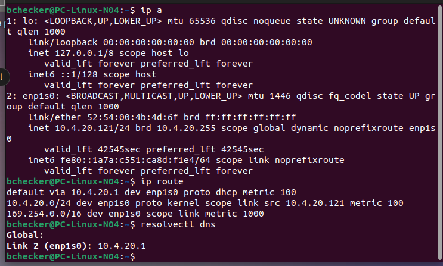

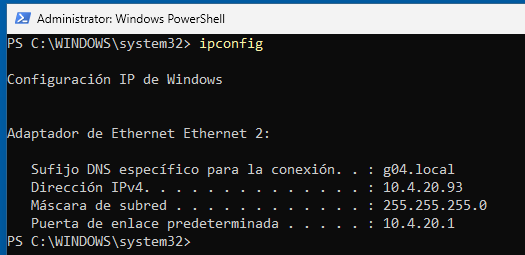

**Prueba 2 · DNS**

```bash
nslookup R-N04          # PC Linux
Resolve-DnsName R-N04   # PC Windows
```

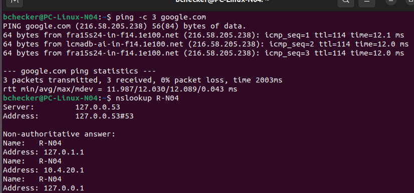

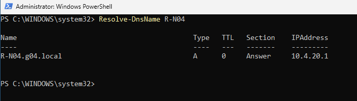

**Prueba 3 · Internet a través del router**

Los equipos de la Intranet no tienen tarjeta Default: salen a Internet por el NAT del router.

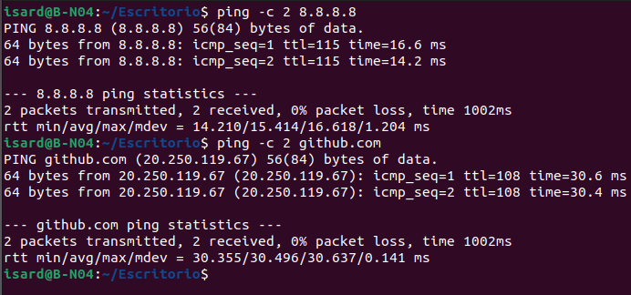

**Pruebas 4 y 5 · Servidores en la DMZ**

Con `tcpdump` en el router se ve que el tráfico de W-N04 entra por `enp4s0` (la DMZ):

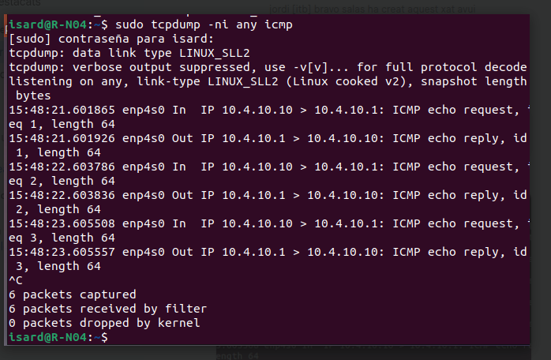

F-N04 llega directamente a W-N04, así que están en la misma red:

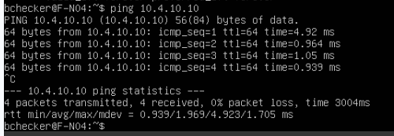

---

## 3. Servicios

**Prueba 6 · Apache**

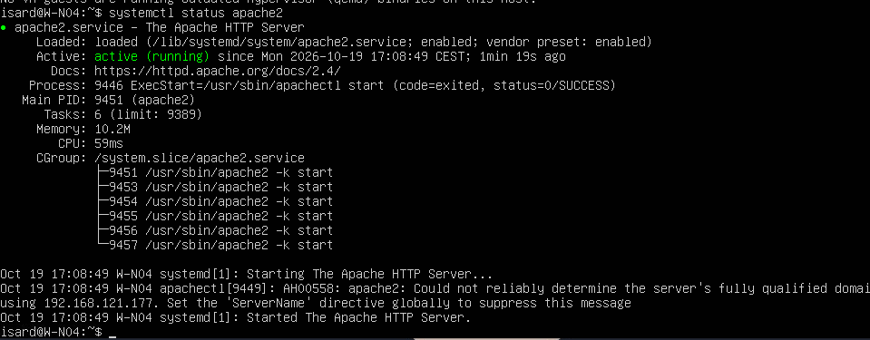

**Prueba 7 · MariaDB**

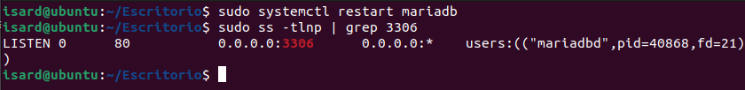

**Pruebas 8 y 9 · FTP**

```bash
ftp -p 10.4.10.20
```

- `230 Login successful` → el usuario entra.
- `pwd` devuelve `/` → está encerrado en su carpeta (chroot).
- `226 Transfer complete` → el archivo se sube en modo pasivo.

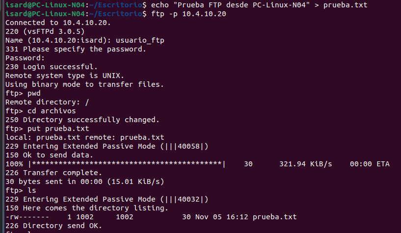

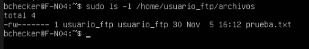

**Prueba 10 · SSH con bchecker**

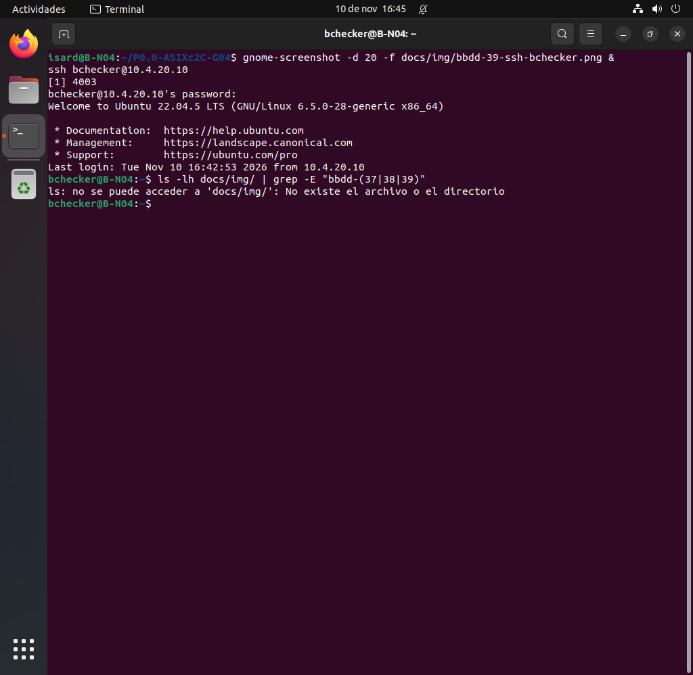

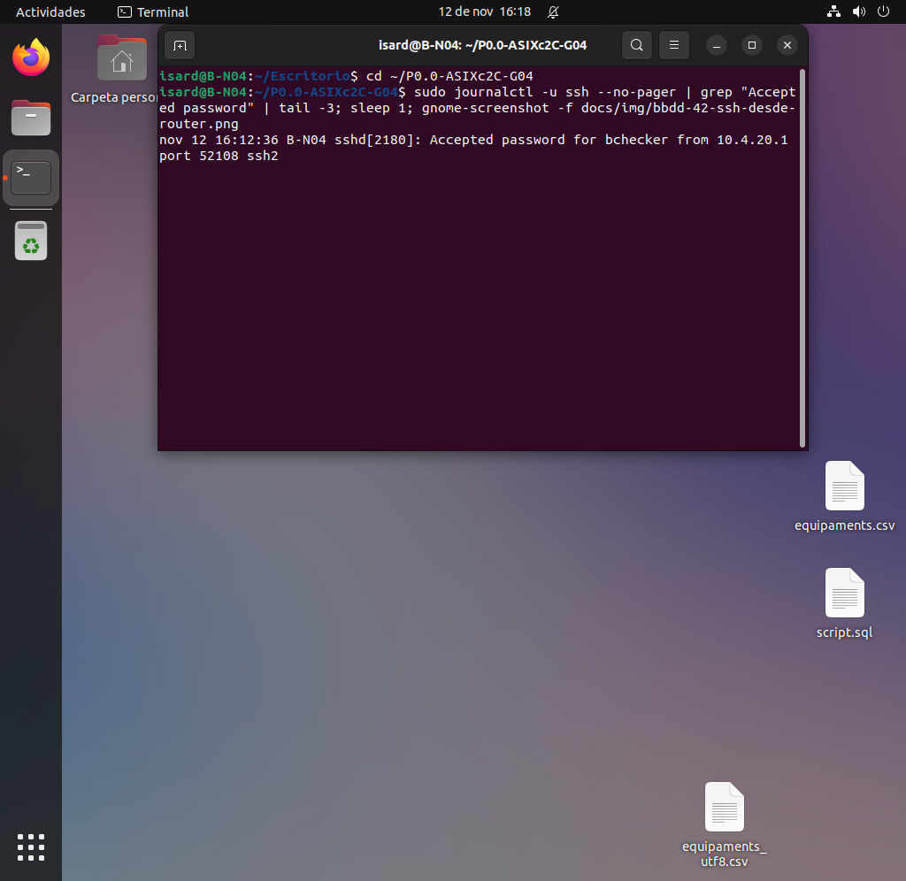

---

## 4. Seguridad entre zonas

El firewall del router solo deja pasar de la DMZ a la Intranet el puerto **3306** desde **W-N04** hacia **B-N04**.

| Prueba | Comando (en W-N04) | Resultado | Significado |
|---|---|---|---|
| 11 · Puerto 3306 | `nc -zv -w 5 10.4.20.10 3306` | ✅ `succeeded` | La aplicación puede usar la base de datos |
| 12 · Puerto 22 | `nc -zv -w 3 10.4.20.10 22` | ⛔ `timed out` | Todo lo demás está bloqueado |

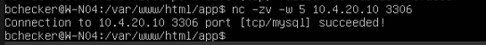

En el router se ve el camino completo: entra por la DMZ (`enp4s0`), sale por la Intranet (`enp3s0`) y la respuesta vuelve:

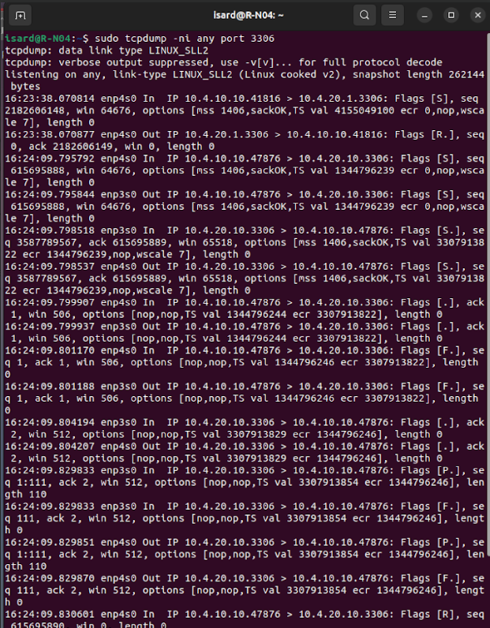

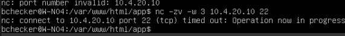

En sentido contrario, la Intranet sí puede entrar por SSH en la DMZ (para administrarla):

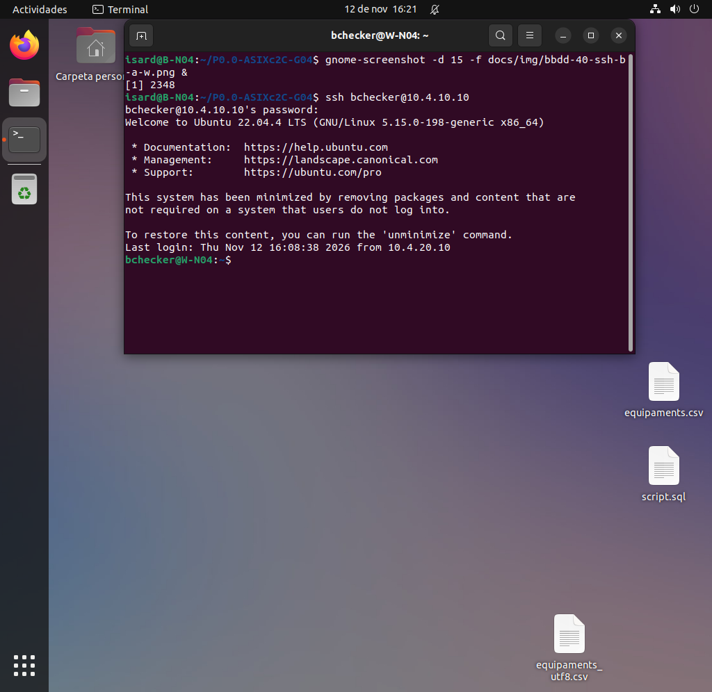

**Prueba 13 · Usuario de la base de datos restringido**

`usuario_app` solo puede conectarse desde la IP de W-N04. Aunque el firewall fallara, MariaDB rechazaría la conexión desde otra máquina.

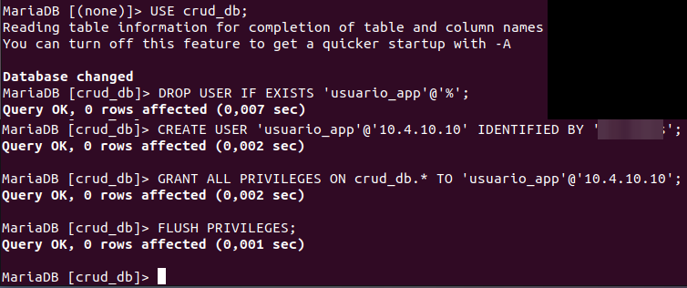

---

## 5. Prueba completa: cliente → web → base de datos

**Prueba 14**

Desde los dos clientes de la Intranet se abre la aplicación por su nombre. Esta prueba valida toda la infraestructura a la vez:

```
PC (Intranet) → DNS del router → router → W-N04 (DMZ) → router → B-N04 (Intranet)
```

La aplicación muestra los **2709 registros** del CSV de Open Data BCN, con los acentos correctos.

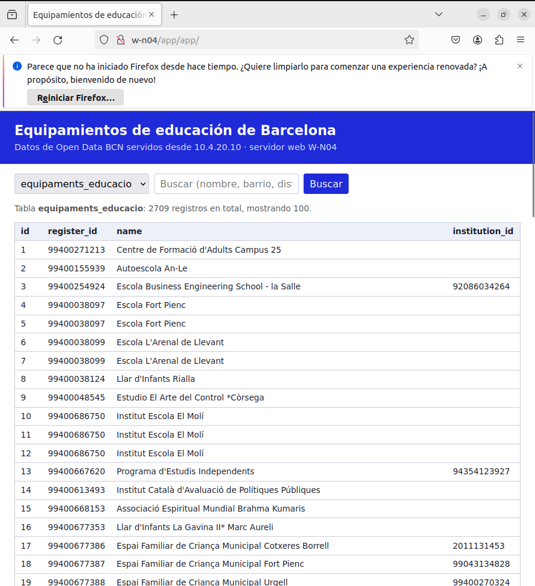

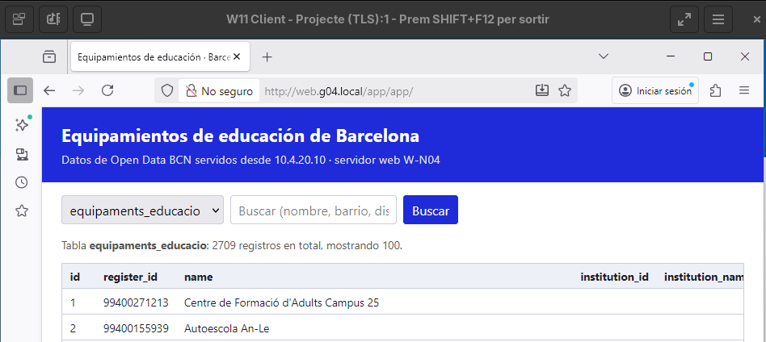
