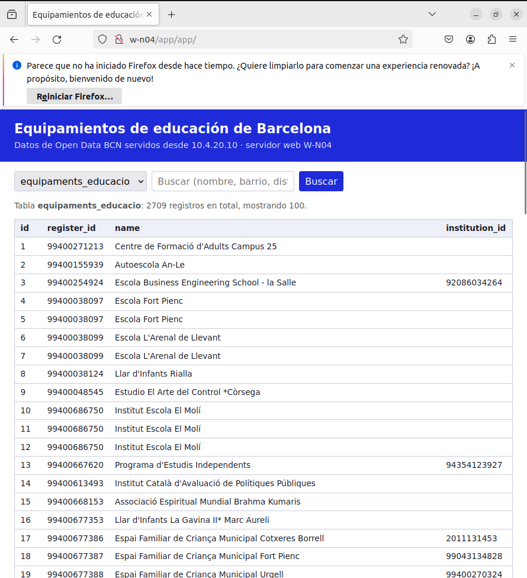
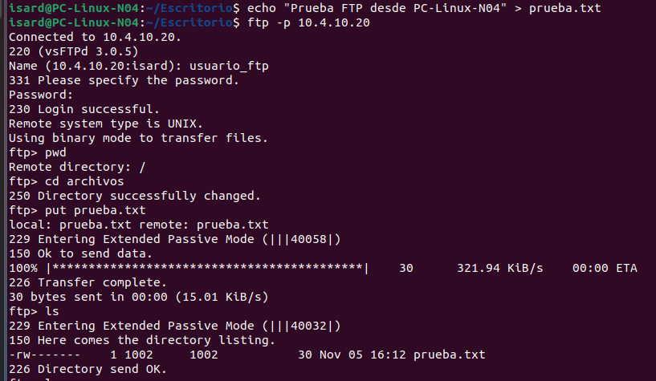

# Manual de usuario

Guía para los empleados que usan la red de la empresa: cómo conectarse, consultar la aplicación de equipamientos educativos y compartir archivos por FTP.

## Índice

1. [Conectarse a la red](#1-conectarse-a-la-red)
2. [Consultar la aplicación](#2-consultar-la-aplicación)
3. [Compartir archivos por FTP](#3-compartir-archivos-por-ftp)
4. [Si algo no funciona](#4-si-algo-no-funciona)

---

## 1. Conectarse a la red

No hay que configurar nada. Al encender el ordenador, la red le da automáticamente una dirección, la salida a Internet y los nombres de los servidores.

Para comprobar que estás conectado:

| Sistema | Comando | Tiene que salir |
|---|---|---|
| Windows | `ipconfig` | Una dirección `10.4.20.x` |
| Linux | `ip a` | Una dirección `10.4.20.x` |

---

## 2. Consultar la aplicación

La aplicación muestra el **listado de equipamientos de educación de Barcelona** (escuelas, institutos, guarderías, academias…), con datos de Open Data BCN.

**1. Abre el navegador** y escribe:

```
http://W-N04/app/app/
```

**2. Busca:** escribe en el buscador un nombre, una calle, un barrio o un distrito (por ejemplo `Gràcia` o `Llar d'Infants`) y pulsa **Buscar**.

**3. Para ver todo otra vez**, borra el texto del buscador y pulsa **Buscar**.



| Lo que ves | Qué significa |
|---|---|
| Desplegable de arriba | La tabla que se consulta (`equipaments_educacio`) |
| "2709 registros en total, mostrando 100" | Hay 2709 registros; la pantalla muestra los 100 primeros. Usa el buscador para encontrar uno concreto |
| Nombres repetidos | Un mismo centro aparece varias veces porque el listado oficial guarda un dato por fila (teléfono, dirección…) |

---

## 3. Compartir archivos por FTP

El servidor FTP sirve para subir y descargar archivos. Necesitas un **usuario y contraseña de FTP**, que te da el administrador. Cada usuario solo ve **su propia carpeta**.

**Desde Linux (terminal):**

```bash
ftp -p 10.4.10.20
```

Escribe tu usuario y tu contraseña. Dentro:

| Para… | Escribe |
|---|---|
| Entrar en tu carpeta de archivos | `cd archivos` |
| Ver los archivos | `ls` |
| Subir un archivo | `put nombre_del_archivo` |
| Descargar un archivo | `get nombre_del_archivo` |
| Salir | `bye` |

Si al subir sale **`226 Transfer complete`**, el archivo se ha subido bien.



**Desde Windows:** se puede usar un programa como **FileZilla** con estos datos:

| Campo | Valor |
|---|---|
| Servidor | `10.4.10.20` |
| Usuario / contraseña | Los que te ha dado el administrador |
| Puerto | `21` |

---

## 4. Si algo no funciona

| Problema | Qué hacer |
|---|---|
| No hay Internet ni red | Comprueba que tienes una dirección `10.4.20.x` (apartado 1). Si no, reinicia el ordenador |
| La página no carga | Prueba con la dirección `http://10.4.10.10/app/app/`. Si así funciona, avisa al administrador (fallo de nombres) |
| La página dice "No se puede conectar con la base de datos" | Avisa al administrador: el servidor de datos no responde |
| El FTP no acepta tu contraseña | Revisa mayúsculas y minúsculas. Si sigue fallando, pide al administrador que revise tu usuario |
| El FTP se queda parado al subir o listar | En Linux, conéctate con `ftp -p` (la `-p` es obligatoria) |

Si el problema continúa, avisa al administrador indicando **qué estabas haciendo** y **qué mensaje te ha salido** (mejor con una captura).
